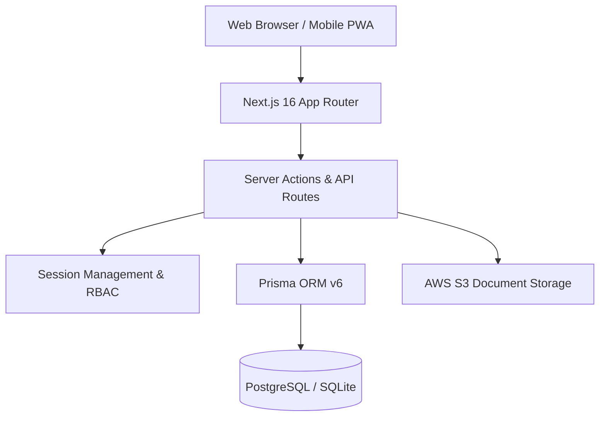

# Glamour Homecare Portal

> **Enterprise Clinical Operations, Caregiver Visit Documentation & Administrative Oversight Platform**  
> Custom-engineered for **Glamour Homecare, LLC** (Fredericksburg, VA) • [glamourhomecare.org](https://glamourhomecare.org)

[](https://nextjs.org/)
[](https://react.dev/)
[](https://www.typescriptlang.org/)
[](https://tailwindcss.com/)
[](https://www.prisma.io/)
[](https://www.postgresql.org/)
[](https://www.hhs.gov/hipaa/index.html)

---

## 📋 Table of Contents

1. [Executive Overview](#-executive-overview)
2. [Key Portals & Functional Workflows](#-key-portals--functional-workflows)
   - [Caregiver Field Portal (`/app`)](#1-caregiver-field-portal-app)
   - [RN Administrator Portal (`/admin`)](#2-rn-administrator-portal-admin)
   - [Individual Patient Chart (`/clients/[id]`)](#3-individual-patient-chart-clientsid)
   - [Authentication & Password Recovery](#4-authentication--password-recovery)
3. [Design System & UI Branding](#-design-system--ui-branding)
4. [Technology Stack](#-technology-stack)
5. [Repository Structure](#-repository-structure)
6. [Getting Started Locally](#-getting-started-locally)
7. [Database Setup & Dual-Engine Switching](#-database-setup--dual-engine-switching)
8. [Environment Configuration](#-environment-configuration)
9. [Build & Quality Assurance](#-build--quality-assurance)
10. [Security & HIPAA Compliance](#-security--hipaa-compliance)

---

## 🌟 Executive Overview

The **Glamour Homecare Portal** is a mission-critical web application designed to digitize and unify daily clinical operations for **Glamour Homecare, LLC**, a licensed home health agency based in Fredericksburg, Virginia.

Prior to this platform, field caregivers documented activities of daily living (ADLs), vitals, and progress reports across fragmented paper logs and disjointed channels. The Glamour Homecare Portal centralizes documentation, eliminates administrative overhead, and enforces rigorous clinical accountability through:

- **Strict Patient Caseload Isolation**: Field employees are strictly isolated to their assigned clients, safeguarding Protected Health Information (PHI).
- **Streamlined Clinical Record Categorization**: Clean classification into 3 approved clinical workflows: **Daily Care Log**, **Discharge Summary**, and **Incident Report**.
- **Structured Vital Signs Tracking**: Real-time logging of blood pressure, heart rate, temperature, blood oxygen saturation (SpO2), respiratory rate, and blood glucose with clinical threshold alerting.
- **24-Hour Clinical Grace Period**: Field caregivers can revise visit notes within 24 hours of submission, with every edit recorded in an immutable audit trail.
- **Global Administrative Oversight**: Live activity feed, staff provisioning, client directory, and comprehensive compliance audit trails for the Supervising Registered Nurse (RN).

---

## 🚀 Key Portals & Functional Workflows

### 1. Caregiver Field Portal (`/app`)
Built for mobile responsiveness on smartphones and tablets carried by field aides and nurses.

- **My Patients**: Clean list of only the patients assigned to the authenticated caregiver. Each card highlights the client's care type, primary address, emergency contact, and instant "Start Visit Note" quick-action.
- **Full-Page Clinical Documentation**:
  - **Category 1 — Daily Care Log**:
    - **ADL Checklist**: Standard activities of daily living checkboxes (Bathing, Dressing, Grooming, Meal Preparation, Mobility Assistance, Toileting, Medication Reminders).
    - **Structured Vitals**: Digital inputs for Temperature (°F/°C), Blood Pressure (Sys/Dia), Pulse (BPM), Oxygen Saturation (% SpO2), Respiratory Rate, and Blood Glucose (mg/dL) with automatic high/abnormal clinical badge alerts.
    - **Clinical Narrative**: Unrestricted observations describing patient demeanor, meals consumed, and behavioral notes.
  - **Category 2 — Discharge Summary**:
    - Clinical discharge narrative and document repository uploader supporting clinical PDFs and PNG scans.
  - **Category 3 — Incident Report**:
    - Standardized incident intake recording exact date/time, detailed description of occurrence, notifications made (supervising nurse, physician, family), and immediate actions taken. Automatically mirrors to clinical notes and notifies administration.
- **Past Logs & 24-Hour Edit Window**:
  - Full history of submitted visit notes.
  - In-place modal editor available strictly within 24 hours of submission.
  - Permanent lock after 24 hours to preserve medical documentation integrity.

### 2. RN Administrator Portal (`/admin`)
Executive clinical operations suite accessible exclusively to users with the `ADMIN` role.

- **Global Activity Feed**:
  - Real-time stream of all clinical notes across all caregivers and clients.
  - Instant multi-parameter filtering:
    - **Clinical Category**: Filter strictly by *Daily Care Log*, *Discharge Summary*, or *Incident Report*.
    - **Caregiver**: Filter by specific staff member.
    - **Client**: Filter by specific patient.
    - **Full-Text Narrative Search**: Real-time search across clinical narrative contents.
- **Client Directory**:
  - Register new clients with demographics, residence address, and emergency contact details.
  - Assign care classification: *Personal Care*, *Companion Care*, *Respite Care*, *Skilled Nursing*, or *Private Duty*.
  - Assign primary caregiver from active staff pool.
  - Maintain individualized care plan summary.
- **Staff Management**:
  - Provision caregiver and administrator accounts with temporary credentials.
  - Assign single or multiple client caseloads via autocomplete client selector.
  - One-click account activation / deactivation with instant session revocation.
- **Compliance Audit Logs**:
  - Immutable timeline capturing all user actions: `LOGIN`, `LOGOUT`, `CREATE`, `UPDATE`, `STATUS_CHANGE`, and `VIEW_PHI`.
  - Date-range and action-type filter controls with instant reset.
  - JSON delta inspector detailing previous vs. updated field values.

### 3. Individual Patient Chart (`/clients/[id]`)
In-depth electronic chart accessible to administrators and the patient's assigned caregiver.

- **Patient Overview Card**: Demographics, primary care type, date of birth, age calculation, address, and primary caregiver.
- **Clinical History Feed**: Filterable chronological ledger of all visit notes, ADLs, and attachments.
- **Structured Vitals Flowsheet**: Tabular flowsheet tracking systolic/diastolic trends, heart rate, temperature, SpO2, and glucose over time.
- **Document Repository**: View and download attached discharge summaries and medical records.
- **Print / Export Summary**: Clean, print-formatted clinical report designed for physician orders, family reviews, and state regulatory audits.

### 4. Authentication & Password Recovery
- **Zero Public Registration**: Accounts are strictly provisioned by administration to prevent unauthorized access.
- **Quick-Demo Switcher**: Built-in credential presets for rapid testing between the Supervising RN Administrator and Field Caregivers.
- **Self-Service Password Reset**: Rate-limited, secure recovery via 6-digit OTP verification codes with 10-minute expiry windows.

---

## 🎨 Design System & UI Branding

The portal adheres to the official **Glamour Homecare** brand identity, blending medical trustworthiness with an approachable, modern aesthetic:

| Token | Color | Usage |
|:---|:---|:---|
| **Primary Brand Pink** | `#DB2777` (`pink-600`) | Primary action buttons, active navigation states, key icons |
| **Hover Brand Pink** | `#BE185D` (`pink-700`) | Button hover states, interactive focus |
| **Active Brand Pink** | `#9D174D` (`pink-800`) | Active button press |
| **Blush Accent** | `#FDF2F8` (`pink-50`) | Active category pills, highlighted list items, light accents |
| **Border Soft Pink** | `#FBCFE8` (`pink-200`) | Subtle borders for badges and highlight containers |
| **Neutral Slate** | `#F8FAFC` to `#0F172A` | Backgrounds, surface cards, divider borders, deep charcoal typography |
| **Clinical Badges** | Emerald / Amber / Blue | Status indicators for active care, vitals alerts, and incident levels |

---

## 🛠 Technology Stack



- **Framework**: [Next.js 16.4](https://nextjs.org/) (App Router, Server Components, Turbopack)
- **UI Library**: [React 19](https://react.dev/)
- **Styling**: [Tailwind CSS v4](https://tailwindcss.com/)
- **Icons**: [Lucide React](https://lucide.dev/)
- **Database & ORM**: [Prisma ORM v6](https://www.prisma.io/) supporting PostgreSQL (production) and SQLite (zero-dependency local development)
- **Object Storage**: [AWS SDK for JavaScript (S3 Client v3)](https://docs.aws.amazon.com/AWSJavaScriptSDK/v3/latest/client/s3/)
- **Security & Cryptography**: Bcrypt password hashing, HTTP-only secure cookie sessions, role-based middleware proxy

---

## 📁 Repository Structure

```
glamour-portal/
├── app/
│   ├── admin/                    # RN Administrator Portal (Dashboard, Activity Feed, Staff, Audit)
│   ├── api/                      # REST API endpoints (Auth, Staff, Clients, Notes, Documents)
│   ├── app/                      # Caregiver Field Portal (Patient Caseload, Visit Logger, History)
│   ├── clients/[id]/             # Individual Patient Chart & Vitals Flowsheet
│   ├── forgot-password/          # Self-service OTP password recovery initiation
│   ├── reset-password/           # OTP validation & new password assignment
│   ├── login/                    # Secure portal authentication
│   ├── layout.tsx                # Root layout with font and metadata configurations
│   ├── page.tsx                  # Smart role-based redirect gateway
│   └── globals.css               # Global Tailwind CSS tokens
├── components/
│   ├── admin/
│   │   └── AdminDashboardClient.tsx   # Admin dashboard client state, feed, and management modals
│   ├── caregiver/
│   │   └── CaregiverDashboardClient.tsx # Caregiver dashboard, full-page note forms, 24h editor
│   ├── client/
│   │   └── ClientDetailView.tsx        # Electronic health record view, vitals flowsheet, print engine
│   ├── vitals/
│   │   ├── VitalsInputFields.tsx      # Structured vitals input component with threshold alerts
│   │   └── VitalsDisplay.tsx          # Clinical vitals badge renderer & flowsheet table
│   └── Navbar.tsx                     # Universal role-aware header navigation bar
├── lib/
│   ├── actions/
│   │   ├── admin-actions.ts           # Admin server actions (staff, clients, feeds, audit logs)
│   │   ├── caregiver-actions.ts       # Caregiver visit logging, incident reporting, 24h edits
│   │   └── password-reset-actions.ts  # Rate-limited OTP generation and verification
│   ├── document-utils.ts              # S3 document resolvers and clinical age calculators
│   ├── prisma.ts                      # Global Prisma client singleton
│   ├── session.ts                     # Authentication verification and RBAC guards
│   └── types.ts                       # TypeScript interfaces, ADL checklists, and NoteCategory enums
├── prisma/
│   ├── schema.prisma                  # Active Prisma schema definition
│   ├── schema.postgresql.prisma       # Dedicated AWS RDS PostgreSQL schema template
│   ├── schema.sqlite.prisma           # Dedicated local SQLite schema template
│   └── seed.ts                        # Seed script with realistic clinical patients, caregivers, and notes
├── scripts/
│   ├── switch-to-postgres.js          # Automated script to activate PostgreSQL schema
│   └── switch-to-sqlite.js            # Automated script to activate SQLite schema
├── public/                            # Static brand logos, icons, and clinical asset illustrations
├── next.config.mjs                    # Next.js compiler and security configurations
├── package.json                       # Project dependencies and operational scripts
└── tsconfig.json                      # Strict TypeScript compiler options
```

---

## 💻 Getting Started Locally

### Prerequisites
- **Node.js**: `v20.x` or higher recommended
- **npm**: `v10.x` or higher

### 1. Clone & Install Dependencies
```bash
git clone https://github.com/Kennysaruni/glamour-portal.git
cd glamour-portal
npm install
```

### 2. Configure Environment Variables
Copy `.env.example` to `.env`:
```bash
cp .env.example .env
```
For local testing, the default SQLite configuration works out of the box with zero external dependencies:
```env
DATABASE_URL="file:./dev.db"
BETTER_AUTH_SECRET="e9b20757876a3bd22d4f5e7c8a1b3d5f"
BETTER_AUTH_URL="http://localhost:3000"
```

### 3. Generate Database & Seed Sample Clinical Data
```bash
npx prisma generate
npx prisma db push
npm run seed
```

### 4. Launch Development Server
```bash
npm run dev
```
Open **[http://localhost:3000](http://localhost:3000)** in your browser.

---

## 🗄 Database Setup & Dual-Engine Switching

The portal supports seamless switching between local SQLite development and AWS RDS PostgreSQL production via included automation scripts:

### Switch to SQLite (Local Dev)
```bash
npm run db:sqlite
npx prisma db push
npm run seed
```

### Switch to PostgreSQL (Production / Staging)
```bash
npm run db:postgres
# Set DATABASE_URL in your .env to your PostgreSQL instance
npx prisma db push
```

### Sample Seed Credentials
The database seed script initializes ready-to-test clinical staff:

| Role | Name | Email | Password |
|:---|:---|:---|:---|
| **Supervising RN Administrator** | Shavonnah | `shavonnah@glamourhomecare.org` | `glamour2025` |
| **Field Caregiver** | Martha Jenkins | `martha@glamourhomecare.org` | `glamour2025` |

---

## ⚙️ Environment Configuration

| Variable | Description | Example / Default |
|:---|:---|:---|
| `DATABASE_URL` | Prisma database connection string | `file:./dev.db` (dev) / `postgresql://...` (prod) |
| `BETTER_AUTH_SECRET` | 32-byte secret for session cookie encryption | `your-32-byte-hex-secret-here` |
| `BETTER_AUTH_URL` | Canonical portal base URL | `https://portal.glamourhomecare.org` |
| `AWS_REGION` | AWS Region for S3 storage | `us-east-1` |
| `AWS_S3_BUCKET` | S3 bucket name for clinical document uploads | `glamour-portal-summaries` |
| `AWS_ACCESS_KEY_ID` | IAM Access Key with PutObject/GetObject permissions | `AKIA...` |
| `AWS_SECRET_ACCESS_KEY` | IAM Secret Access Key | `wJalrXUtnFEMI...` |

---

## 🧪 Build & Quality Assurance

To validate TypeScript compilation, route bundling, and lint checks:

```bash
# Run lint check
npm run lint

# Build production bundle
npm run build

# Start production server
npm run start
```

---

## 🔒 Security & HIPAA Compliance

The Glamour Homecare Portal is architected in accordance with HIPAA Security Rule specifications:

1. **Strict Data Segregation**: Field employees can only query, view, and document notes for patients explicitly assigned to their caseload by an administrator.
2. **Immutable Audit Trail**: All authentication events, patient record views, visit log submissions, and clinical updates are recorded in the `AuditLog` table with timestamp, user ID, IP address, and JSON diffs.
3. **Session Hardening**: Sessions are maintained exclusively via HTTP-only, secure, `SameSite=Lax` cookies with server-side role validation.
4. **24-Hour Immutability Gate**: Clinical notes become permanent and non-editable after 24 hours to ensure audit compliance and prevent retroactive documentation alteration.
5. **Rate-Limited Password Recovery**: Single-use 6-digit OTP codes are stored as SHA-256 hashes, strictly limited to 5 attempts, and expire automatically after 10 minutes.

---

## 📄 License & Ownership

Proprietary Software — Copyright © 2025–2026 **Glamour Homecare, LLC**. All rights reserved.  
Unauthorized distribution, copying, or modification is strictly prohibited.
